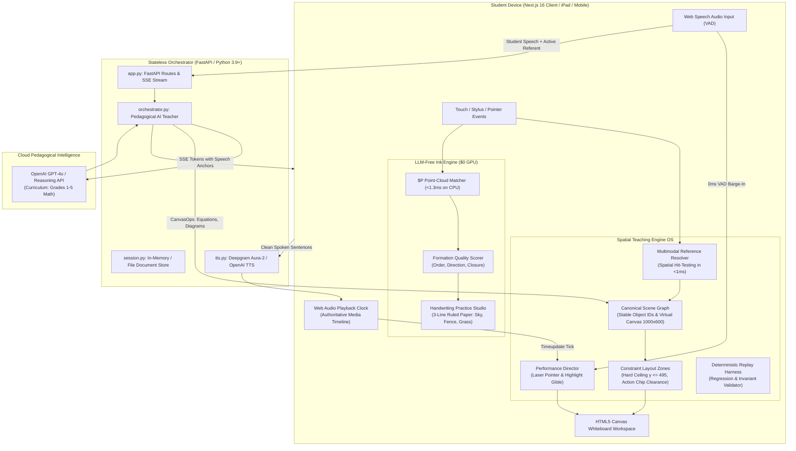

<!-- BEGIN:nextjs-agent-rules -->

# This is NOT the Next.js you know

This version has breaking changes — APIs, conventions, and file structure may all differ from your training data. Read the relevant guide in `node_modules/next/dist/docs/` (resolved from this file's directory; in monorepos the `next` package may not be visible from the repo root) before writing any code. Heed deprecation notices.

This block is written and re-added by `next dev` — verify at `node_modules/next/dist/server/lib/generate-agent-files.js`. Removing it from a diff only re-creates the uncommitted change; committing it with your work keeps the tree clean.

<!-- END:nextjs-agent-rules -->

# Zawvee Spatial Teaching & Handwriting Intelligence Engine
## Authoritative Architecture & Agent Guidelines

> **Primary Architecture Reference**: [`docs/ARCHITECTURE.md`](file:///Users/product/Primer%20v2/docs/ARCHITECTURE.md)  
> **Primary Source Specifications**:
> - `Public/JAWVEE_Spatial_Teaching_Engine_PRD_Deep_Research.pdf` (Spatial Teaching Engine OS)
> - `Public/JAWVEE_LLM_Free_Handwriting_Intelligence_Engine.pdf` (LLM-Free Digital Ink & Handwriting Subsystem)
> - `docs/Zawvee_Foundation_Revamp_PRD.md` (Foundation Revamp Experience)

---

## 1. Product Identity & Pedagogical Mental Model

Zawvee is a **multimodal AI whiteboard teacher** built for elementary students (Grades 1 to 5).
- **The Elementary Teacher Mental Model**:
  - The teacher **speaks aloud** with natural warmth, patience, and conversational clarity.
  - The whiteboard is reserved **strictly for blackboard work**: publication-grade KaTeX formulas, clean geometric diagrams, and concise 1–2 word labels.
  - The tutor **never writes conversational paragraphs or transcripts on the canvas**.
- **Foundational Curriculum Boundary (Grades 1 to 5 & Introductory Algebra)**:
  - Foundational models: Ten-Frames (`ten_frame`), Multiplication Arrays (`array_model`), Number Lines (`number_line`), Fraction Strips (`fraction_bar`), Fraction Circles (`fraction_circle`), Tape Diagrams (`tape_diagram`), basic 2D geometry (`rect`, `circle`, `triangle`), and Coordinate Graphs / Slope-Intercept (`slope_intercept`).
  - **Zero University Physics or Calculus**: Under no circumstances should the system output advanced university physics (relativity, quantum mechanics, black holes, thermodynamics) or higher calculus.

---

## 2. High-Level Architecture Diagram



---

## 3. Codebase Directory Structure

```
/Users/product/Primer v2/
├── AGENTS.md                  # This file: Authoritative instructions for AI Agents
├── package.json               # Monorepo root scripts (npm run dev, backend, build)
├── .env                       # API keys (OPENAI_API_KEY, DEEPGRAM_API_KEY, etc.)
│
├── frontend/                  # Next.js 16 Web Application (App Router, Turbopack)
│   ├── app/
│   │   ├── page.tsx           # Main application view (Whiteboard, Tutor Island, Studio)
│   │   ├── layout.tsx         # Root HTML layout and font definitions
│   │   └── globals.css        # Core typography, dark/light mode tokens
│   ├── components/
│   │   ├── canvas/
│   │   │   ├── CanvasWorkspace.tsx       # Whiteboard canvas, viewport matrix, student touch
│   │   │   ├── CanvasToolbar.tsx         # Bencho glassmorphism floating bottom toolbar
│   │   │   ├── AiPointerOverlay.tsx      # Spring-animated AI pointer with tooltip message
│   │   │   ├── AnimatedShapeRenderer.tsx # Vector stroke and procedural shape renderer
│   │   │   ├── TutorCanvasOverlay.tsx    # Live island: mic, captions, FF, action chips
│   │   │   └── HandwritingPracticeOverlay.tsx # Ruled 3-line paper & formation feedback
│   │   ├── talk/
│   │   │   └── ChatPanel.tsx             # Conversational transcript view (Talk mode)
│   │   └── zawvee/
│   │       └── Navbar.tsx                # Top navigation: brand, status, audio, studio toggle
│   ├── lib/
│   │   ├── sceneGraph/
│   │   │   ├── types.ts                  # SemanticObject, BoundingBox, SceneGraph contracts
│   │   │   ├── sceneManager.ts           # Authoritative SceneGraph singleton & hit-testing
│   │   │   ├── layoutEngine.ts           # Constraint layout zones & clearance solver
│   │   │   ├── performanceTypes.ts       # PerformanceAnchor, Action, TeachingPerformancePlan
│   │   │   ├── performanceParser.ts      # Anchor tag parser & fractional timing compiler
│   │   │   ├── performanceDirector.ts    # Audio-clock performance director singleton
│   │   │   └── replayHarness.ts          # Deterministic session replay & regression harness
│   │   ├── inkEngine/
│   │   │   └── recognizer.ts             # $P Point-Cloud Matcher (<1.3ms) & formation evaluator
│   │   ├── elementaryMathModels.ts       # Ten-frame, array model, number line, fraction bars
│   │   ├── sketchEngine.ts               # Procedural math sketches, SVG parser, KaTeX cleaner
│   │   ├── handwritingEngine.ts          # Catmull-Rom vector digital ink renderer
│   │   ├── katexSafe.ts                  # Error-tolerant KaTeX math formula renderer
│   │   ├── useTutorPerformance.ts        # Whiteboard step animator with barge-in reconciliation
│   │   ├── useTutorVoice.ts              # Pipelined Web Audio player with timeupdate sync
│   │   ├── useVoiceInput.ts              # Web Speech API speech-to-text with 0ms VAD hook
│   │   ├── api.ts                        # Client API client and SSE stream consumer
│   │   └── types.ts                      # Common application types and interfaces
│   └── capacitor.config.ts               # Cross-platform iPad (Apple Pencil) & Android config
│
├── backend/                   # Python FastAPI Backend Microservice
│   ├── app.py                 # FastAPI endpoints (HTTP sessions, canvas ops, TTS, SSE stream)
│   ├── orchestrator.py        # Pedagogical AI tutor, system prompts, anchor generation
│   ├── models.py              # Pydantic data models (ChatMessage, CanvasOp, SemanticObject)
│   ├── session.py             # In-memory document tree and session store
│   └── requirements.txt       # Python dependencies (fastapi, uvicorn, openai, sse-starlette)
│
├── docs/                      # Architectural & PRD Documentation
│   ├── ARCHITECTURE.md        # Comprehensive system specification
│   ├── ZAWVEE_FOUNDATION_REVAMP_ARCHITECTURE.md
│   ├── Zawvee_Foundation_Revamp_PRD.md
│   └── Zawvee_Foundation_Revamp_PRD.docx
│
└── Public/                    # Primary Source Specifications
    ├── JAWVEE_Spatial_Teaching_Engine_PRD_Deep_Research.pdf
    └── JAWVEE_LLM_Free_Handwriting_Intelligence_Engine.pdf
```

---

## 4. Architectural Invariants for AI Coding Agents

When editing or extending this codebase, you **must adhere to these invariants**:

1. **Virtual Coordinate Space ($1000 \times 600$)**:
   - Never author whiteboard coordinates in raw screen pixels.
   - Always use `sceneManager.virtualToScreen` and `sceneManager.screenToVirtual` when bridging user input or pointer targets to the canvas container.
2. **Hard Action-Chip Ceiling ($y \le 495$)**:
   - Whiteboard cards and diagrams must NEVER extend past $y = 495$ in virtual coordinates.
   - This reserves a dedicated $\ge 90\text{px}$ clearance margin for floating action chips and toolbars.
3. **Pure KaTeX Math Typography**:
   - Math equations must ALWAYS be rendered via KaTeX (`{"kind": "math", "latex": "..."}`).
   - Double-escape backslashes in JSON payloads (e.g. `"\\frac{3}{4}"`). Never write raw formulas in hand-drawn stroke text.
4. **Teaching Performance Speech Anchors**:
   - In spoken teacher responses, wrap referenced entities with `<anchor id="..." target="visual_model|equation|title">spoken phrase</anchor>`.
   - Never send XML tags to TTS. The parser (`performanceParser.ts`) strips tags and computes fractional playback progress.
5. **Zero-Latency Barge-In Interruption**:
   - Mic input immediately triggers `voiceOutput.stop()` and `tutor.interrupt()`.
   - Reconcile in-flight drawing: commit if $\ge 80\%$ complete; purge ghost strokes if $< 80\%$.
   - Preserve `InterruptionSnapshot` and pass it to the backend on the next turn.
6. **Zero Server GPU Dependencies**:
   - Keep handwriting recognition and formation scoring client-side using `frontend/lib/inkEngine/recognizer.ts` ($P Point-Cloud Matcher, $<1.3\text{ms}$ on CPU).

