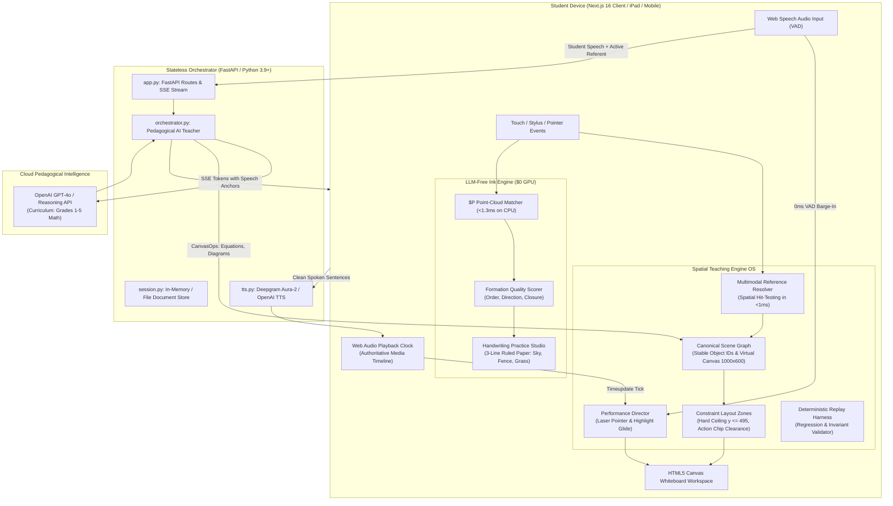

# Zawvee Spatial Teaching & Handwriting Intelligence Engine
## Complete Product & Technical Architecture Guide

> **Document Status**: Production Architecture & Engineering Reference  
> **Target Audience**: AI Agents, Systems Engineers, Frontend/Backend Developers  
> **Source Specifications**: 
> 1. `Public/JAWVEE_Spatial_Teaching_Engine_PRD_Deep_Research.pdf` (Spatial Teaching Engine OS)
> 2. `Public/JAWVEE_LLM_Free_Handwriting_Intelligence_Engine.pdf` (LLM-Free Digital Ink & Handwriting Subsystem)
> 3. `docs/Zawvee_Foundation_Revamp_PRD.md` (Foundation Revamp Experience)

---

## 1. System Vision & Core Product Thesis

Zawvee is a **multimodal AI whiteboard teacher** built for elementary students (Grades 1 to 5). It replaces traditional static chatbots with a dynamic, spatially grounded teaching operating system.

### Core Architectural Mandates
1. **The Elementary Teacher Mental Model**:
   - The tutor **speaks aloud** with natural warmth, encouragement, and patience using pipelined low-latency TTS.
   - The whiteboard is reserved **strictly for blackboard work**: crisp KaTeX formulas, clean geometric diagrams, and concise 1–2 word labels.
   - Spoken context is **never dumped as conversational paragraphs or transcripts on the canvas**.
2. **One World, One Truth (Canonical Scene Graph)**:
   - The whiteboard canvas is represented by an authoritative **Semantic Scene Graph** with persistent entity IDs, bounding boxes, and typed relationships.
   - The LLM never invents arbitrary screen pixel coordinates $(x, y)$. It outputs semantic actions, and the client constraint engine maps them to a responsive $1000 \times 600$ virtual canvas.
3. **Teaching as a Performance (Audio-Clock Synchronization)**:
   - Speech, blackboard writing, laser pointing, and glow highlights are scheduled as **one unified performance** driven directly by the authoritative Web Audio playback clock.
   - Pen tips and pointer targets glide to visual elements on the exact syllable they are vocalized.
4. **Fast-Path Barge-In & Interruption Lifecycle**:
   - A student voice interruption immediately halts audio (0ms VAD), freezes in-flight visual drawing, and reconciles state ($\ge 80\%$ complete commits; $< 80\%$ purges ghost strokes).
   - A temporal memory snapshot (`InterruptionSnapshot`) is captured and supplied to the tutor so it can warmly acknowledge the interruption.
5. **Multimodal Spatial Reference Resolution**:
   - Sub-millisecond ($<1\text{ms}$) spatial hit-testing on the Scene Graph allows students to point at or touch any element and ask deictic questions (*"What is this?"*, *"Why is this 12?"*).
6. **Zero-GPU Client-Native Intelligence**:
   - 95% of spatial computing, hit-testing, layout constraint solving, and digital ink recognition runs client-side in the student's browser in $<2\text{ms}$ on CPU ($0 server GPU cost).

---

## 2. High-Level Architecture Diagram



---

## 3. Codebase Structure & Directory Map

```
/Users/product/Primer v2/
├── AGENTS.md                  # Authoritative instructions for AI Coding Agents
├── package.json               # Monorepo root scripts (npm run dev, backend, build)
├── .env                       # API keys (OPENAI_API_KEY, DEEPGRAM_API_KEY, etc.)
│
├── frontend/                  # Next.js 16 Web Application (App Router, Turbopack)
│   ├── app/
│   │   ├── page.tsx           # Main application view (Whiteboard, Tutor Island, Studio)
│   │   ├── layout.tsx         # Root HTML layout and font definitions
│   │   └── globals.css        # Core typography, dark/light mode tokens
│   ├── components/
│   │   ├── canvas/
│   │   │   ├── CanvasWorkspace.tsx       # Whiteboard canvas, viewport matrix, student touch
│   │   │   ├── CanvasToolbar.tsx         # Bencho glassmorphism floating bottom toolbar
│   │   │   ├── AiPointerOverlay.tsx      # Spring-animated AI pointer with tooltip message
│   │   │   ├── AnimatedShapeRenderer.tsx # Vector stroke and procedural shape renderer
│   │   │   ├── TutorCanvasOverlay.tsx    # Live island: mic, captions, FF, action chips
│   │   │   └── HandwritingPracticeOverlay.tsx # Ruled 3-line paper & formation feedback
│   │   ├── talk/
│   │   │   └── ChatPanel.tsx             # Conversational transcript view (Talk mode)
│   │   └── zawvee/
│   │       └── Navbar.tsx                # Top navigation: brand, status, audio, studio toggle
│   ├── lib/
│   │   ├── sceneGraph/
│   │   │   ├── types.ts                  # SemanticObject, BoundingBox, SceneGraph contracts
│   │   │   ├── sceneManager.ts           # Authoritative SceneGraph singleton & hit-testing
│   │   │   ├── layoutEngine.ts           # Constraint layout zones & clearance solver
│   │   │   ├── performanceTypes.ts       # PerformanceAnchor, Action, TeachingPerformancePlan
│   │   │   ├── performanceParser.ts      # Anchor tag parser & fractional timing compiler
│   │   │   ├── performanceDirector.ts    # Audio-clock performance director singleton
│   │   │   └── replayHarness.ts          # Deterministic session replay & regression harness
│   │   ├── inkEngine/
│   │   │   └── recognizer.ts             # $P Point-Cloud Matcher (<1.3ms) & formation evaluator
│   │   ├── elementaryMathModels.ts       # Ten-frame, array model, number line, fraction bars
│   │   ├── sketchEngine.ts               # Procedural math sketches, SVG parser, KaTeX cleaner
│   │   ├── handwritingEngine.ts          # Catmull-Rom vector digital ink renderer
│   │   ├── katexSafe.ts                  # Error-tolerant KaTeX math formula renderer
│   │   ├── useTutorPerformance.ts        # Whiteboard step animator with barge-in reconciliation
│   │   ├── useTutorVoice.ts              # Pipelined Web Audio player with timeupdate sync
│   │   ├── useVoiceInput.ts              # Web Speech API speech-to-text with 0ms VAD hook
│   │   ├── api.ts                        # Client API client and SSE stream consumer
│   │   └── types.ts                      # Common application types and interfaces
│   └── capacitor.config.ts               # Cross-platform iPad (Apple Pencil) & Android config
│
├── backend/                   # Python FastAPI Backend Microservice
│   ├── app.py                 # FastAPI endpoints (HTTP sessions, canvas ops, TTS, SSE stream)
│   ├── orchestrator.py        # Pedagogical AI tutor, system prompts, anchor generation
│   ├── models.py              # Pydantic data models (ChatMessage, CanvasOp, SemanticObject)
│   ├── session.py             # In-memory document tree and session store
│   └── requirements.txt       # Python dependencies (fastapi, uvicorn, openai, sse-starlette)
│
├── docs/                      # Architectural & PRD Documentation
│   ├── ARCHITECTURE.md        # This comprehensive system guide
│   ├── ZAWVEE_FOUNDATION_REVAMP_ARCHITECTURE.md
│   ├── Zawvee_Foundation_Revamp_PRD.md
│   └── Zawvee_Foundation_Revamp_PRD.docx
│
└── Public/                    # Primary Source Specifications
    ├── JAWVEE_Spatial_Teaching_Engine_PRD_Deep_Research.pdf
    └── JAWVEE_LLM_Free_Handwriting_Intelligence_Engine.pdf
```

---

## 4. Key Subsystem Specifications

### 4.1 Canonical Scene Graph & Universal Virtual Viewport
- **Universal Coordinate Space**: All diagrams and math objects are authored within a standardized $1000 \times 600$ virtual canvas (aspect ratio $5:3$).
- **Responsive Projection Matrix**:
  $$\text{scale} = \min\left(\frac{W_{\text{viewport}}}{1000}, \frac{H_{\text{viewport}} - \text{dockHeight}}{600}\right)$$
  $$\text{offsetX} = \frac{W_{\text{viewport}} - 1000 \times \text{scale}}{2}, \quad \text{offsetY} = \frac{H_{\text{usable}} - 600 \times \text{scale}}{2}$$
- **Constraint Layout Zones**:
  - *Header Zone* ($y: 20 - 70$): Topic title pill.
  - *Primary Equation Zone* ($y: 85 - 140$): Main formula card (e.g. $3 \times 4 = 12$).
  - *Visual Model Zone* ($y: 155 - 410$): Multiplication array, ten-frame, number line, fraction bar.
  - *Conclusion Zone* ($y: 425 - 490$): Final answer card.
  - *Hard Ceiling Invariant*: No card bottom extends past $y = 495$, leaving $\ge 90\text{px}$ dedicated clearance for student action chips and toolbar.

### 4.2 Teaching Performance Protocol & Audio-Clock Sync
- **Speech Anchors**: Spoken words referencing whiteboard visual elements are tagged via XML:
  `"Look at the <anchor id='arr' target='visual_model'>three rows of dots</anchor>. The total is <anchor id='tot' target='equation'>12</anchor>!"`
- **Compiler**: `performanceParser.ts` calculates fractional progress ($0.0 \to 1.0$) for each anchor and strips XML tags before sending speech text to TTS.
- **Master Media Clock**: `audio.ontimeupdate` continuously invokes `performanceDirector.tick(currentTimeMs, totalDurationMs)`. The AI laser pointer glides to target coordinates smoothly without arbitrary timers or network latency drift.

### 4.3 Fast-Path Barge-In & Temporal Memory
- **0ms Voice Activity Detection (VAD)**: Student microphone input (`onSpeechDetected` in `useVoiceInput.ts`) immediately stops audio playback and triggers `tutor.interrupt()`.
- **State Reconciliation**:
  - If the in-flight drawing step is $\ge 80\%$ complete: cleanly commits the object to preserve near-finished work.
  - If $< 80\%$ complete: cleanly purges in-flight ghost strokes to prevent half-drawn clutter.
- **Interruption Context Injection**: `performanceDirector` records an `InterruptionSnapshot` (`interruptedAtMs`, `targetObjectId`, `targetObjectLabel`, `targetObjectRole`). This is passed to the backend prompt on the next chat turn so the tutor acknowledges the student naturally (*"You caught me right as I was showing the array dots! Let's answer your question..."*).

### 4.4 Multimodal Spatial Reference Resolution
- **Sub-millisecond Spatial Hit-Testing**: On student touch/stylus down, `sceneManager.hitTest(screenToVirtual(x, y), 45)` resolves enclosing and proximate objects in $<1\text{ms}$.
- **Deictic Resolution**: Touched entity attributes (`objectId`, `semanticType`, `label`, `role`) are forwarded to the chat stream. When the child asks *"What is this?"* or *"Why is this 12?"*, the tutor resolves the pronoun to the specific blackboard object.

### 4.5 LLM-Free Handwriting Intelligence Subsystem
- **$P Point-Cloud Recognizer**: Resamples student strokes into 32 points, normalizes to a standard bounding box, translates to centroid $(0,0)$, and computes greedy Euclidean distance against standard templates. Matches digits and letters in **$<1.3\text{ms}$ on CPU** ($0 GPU cost).
- **Formation Quality Evaluation**: Checks stroke count, top-to-bottom writing direction, and loop closure.
- **Handwriting Practice Studio**: Interactive 3-line ruled paper (Headline/Sky, Midline/Fence, Baseline/Grass) with template tracing, starting dots, and live pedagogical coaching.

### 4.6 Deterministic Replay & Regression Harness
- **Event-Sourced Logging**: `replayHarness.ts` records typed session events with millisecond timestamps (`ai_speak`, `scene_add`, `pointer_glide`, `student_touch`, `student_barge_in`).
- **Automated Validation**: Replays traces offline to verify that no formula cards collide and no elements violate the $y \le 495$ safe clearance boundary.

---

## 5. Verification & Development Runbook

### Starting Development Servers
```bash
# Terminal 1: Frontend (Next.js 16 Turbopack)
cd frontend
npm run dev

# Terminal 2: Backend (FastAPI Python)
cd "Primer v2"
./.venv/bin/uvicorn backend.app:app --port 8000 --reload
```

### Running System Verification & Type Checks
```bash
# Verify Frontend TypeScript & Production Build
cd frontend
npm run build

# Verify Backend Python Compilation
cd "Primer v2"
./.venv/bin/python -m py_compile backend/app.py backend/orchestrator.py backend/models.py backend/session.py

# Run Handwriting Recognizer & Replay Regression Benchmark
cd frontend
npx tsx -e "
import { recognizeHandwriting, evaluateFormationQuality } from './lib/inkEngine/recognizer';
import { textToStrokes } from './lib/handwritingEngine';
const s = textToStrokes('A', { x: 100, y: 100 }, { size: 100 });
console.log('Recognized:', recognizeHandwriting(s));
console.log('Formation:', evaluateFormationQuality(s, 'A'));
"
```
